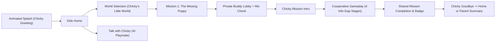
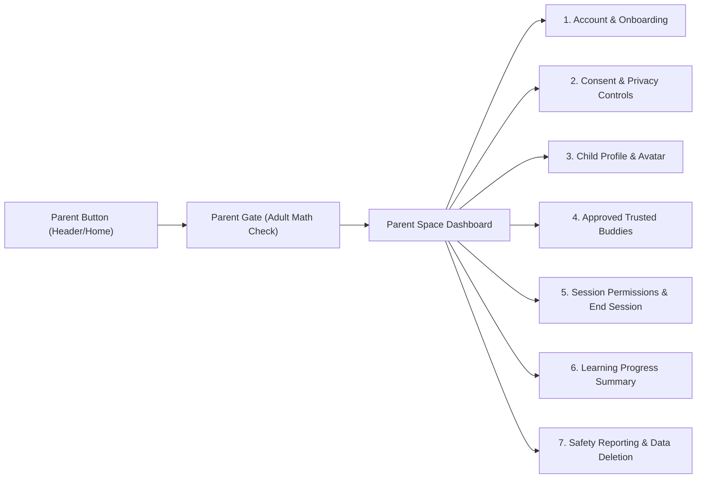

# Chicken Talk — UX Flows & Navigation Principles

## 1. Navigation Principles (Kids Space)

- **One obvious primary action per screen** (e.g., big golden CTA on Kids Home, clear Play button on World 1).
- **Illustration & audio first**: Chicky speaks greetings, clues, and recasts using Web Speech API (with clear subtitles and zero walls of text).
- **Large touch targets**: Minimum `48px–56px` interactive targets with pillowy tactile feedback.
- **Tablet-landscape-first layout**: Wide two-column / stage-plus-guide playground layout on tablet & desktop, gracefully stacking on portrait screens.
- **Always-visible kid safety controls**: Mute (`🔊/🔇`), Help (`💡`), Pause (`⏸`), and Safe Exit (`🚪`).
- **Zero ads, zero purchases, zero external outbound links** in Kids Space.

## 2. End-to-End Kids Space Flow

## 3. Parent Space Flow

## 4. Screen Inventory

### Kids Space
1. **Animated Splash Screen**: Chicken Talk SVG logo, Chicky waving (`greeting`), tagline, and `"Let's Play!"` button.
2. **Kids Home**: Personalized Chicky greeting, primary `"Explore Chicky's Little World"` CTA, Quick Play *The Missing Puppy*, and *Talk with Chicky*.
3. **World Selection**: 3 illustrated world cards — World 1 playable (*The Magic Garden*), Worlds 2–3 previewed with target language chips.
4. **Private Buddy Lobby & Mic Check**: Approved buddy selector (clearly marked Demo Bot vs Approved Buddy), Explorer Role selector (Map Scout / Clue Spotter), live Audio/Mic readiness test, and Picture-Card fallback assurance.
5. **Chicky Mission Introduction**: Illustrated modal/overlay introducing Milo's story before Stage 1 begins.
6. **Cooperative Gameplay (The Magic Garden)**: Interactive SVG 2.5D scene, step progress bar, Explorer Clue Panel, Simulated Buddy panel (labeled Demo Mode), Chicky live guide with Level 0–3 hints, Push-to-Talk mic, and Picture Action Cards.
7. **Mission Completion & Goodbye**: Celebrating Chicky + Milo + Luna, phrases practiced recap, cooperative badge, and gentle goodbye wave.

### Parent Space
- Tabbed/sectioned calm parent interface separated by Parent Gate, keeping all adult forms and analytics cleanly out of Kids Space.
